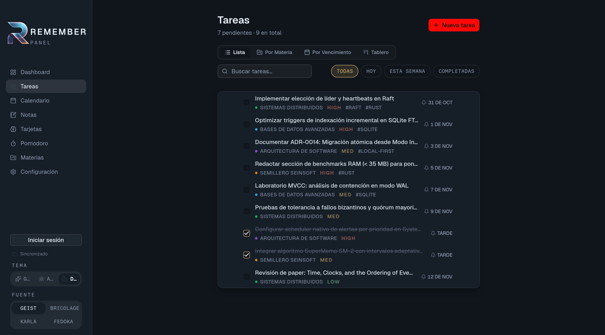
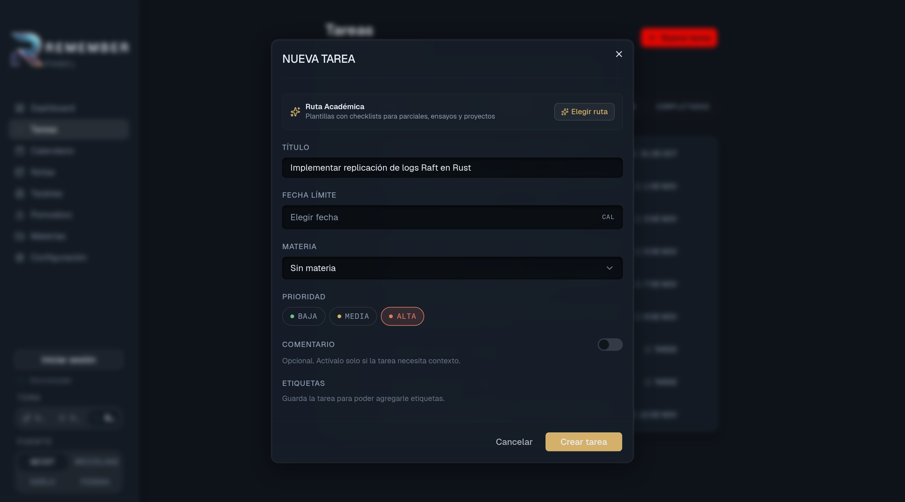
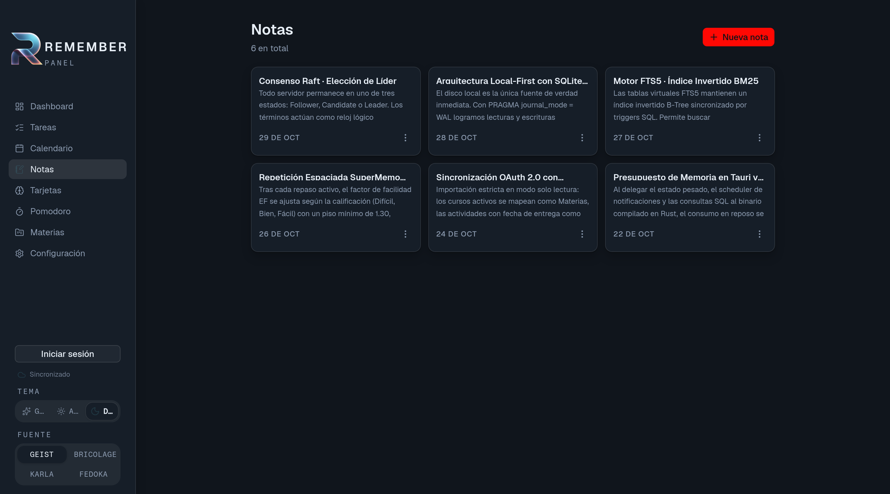
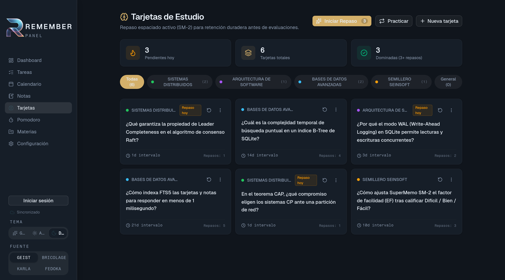
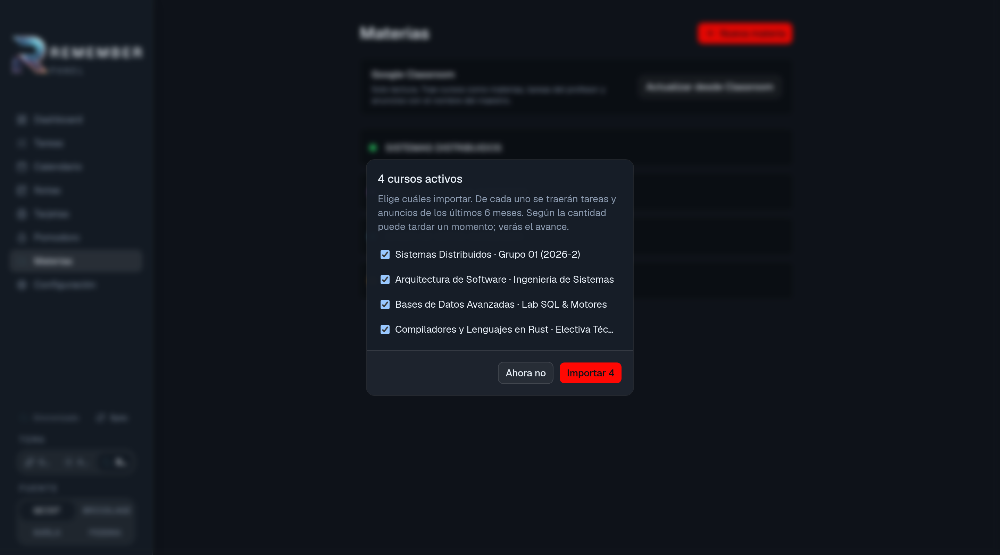
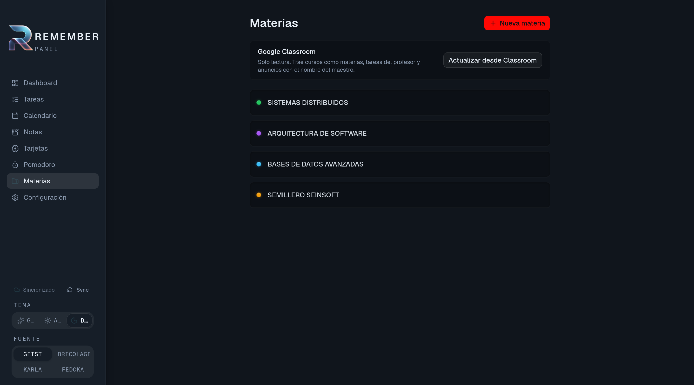
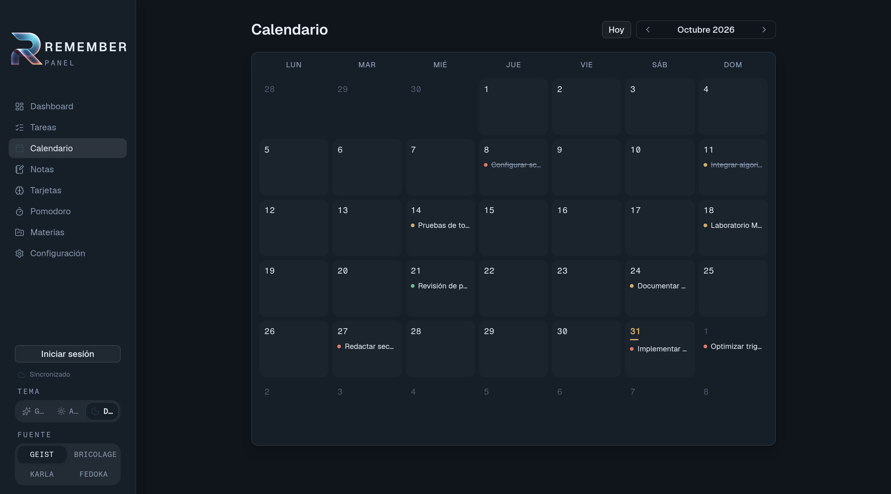
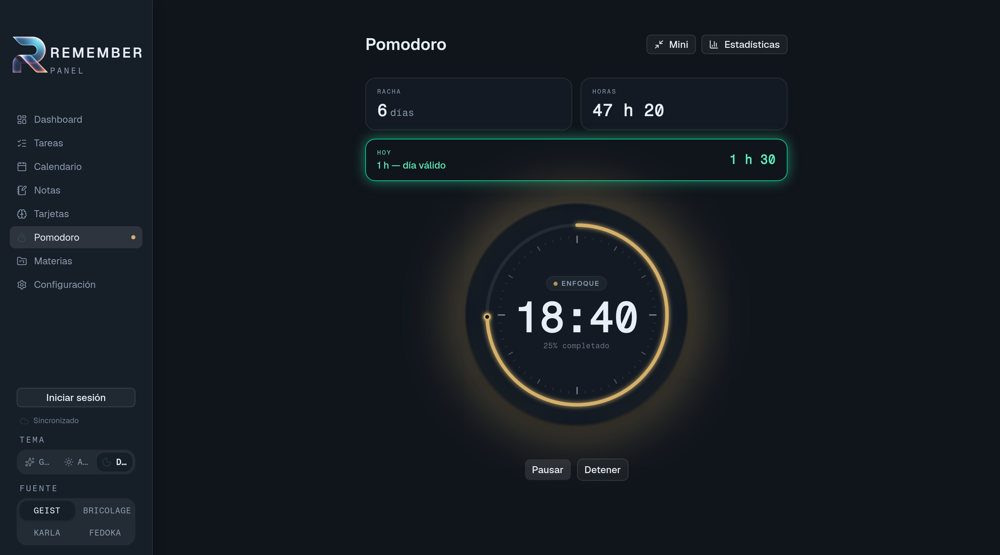
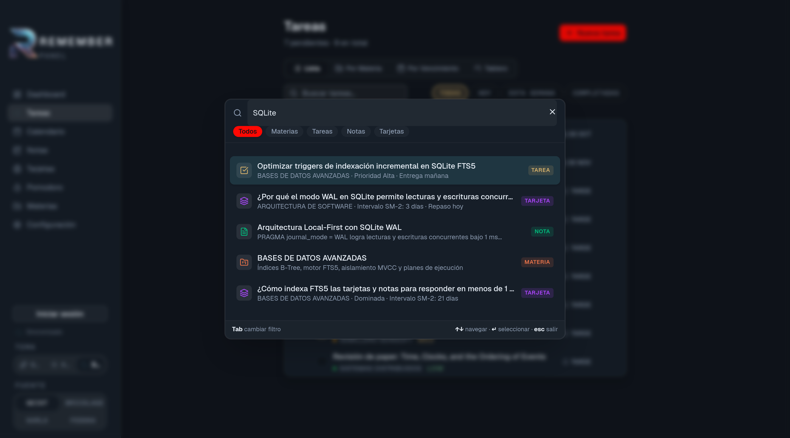

  

  # REMEMBER

  **Estación de trabajo y estudio personal Local-First con sincronización opcional**  
  *Construida con Tauri v2, Rust, SQLite (WAL + FTS5) y React.*

  
  
  
  
  
  

   

  [**Sitio Web Oficial**](https://www.isremember.com) • [**Solicitar Acceso a la Beta**](https://www.isremember.com#waitlist) • [**Reportar un Error (Issues)**](https://github.com/Alejandro11R/REMEMBER-desktop/issues) • [**Política de Seguridad**](./SECURITY.md) • [**Privacidad**](https://www.isremember.com/privacy)

---

## Filosofía Anti-Bloat & Arquitectura Local-First

Las aplicaciones modernas de productividad académica suelen sufrir de **sobrecarga de memoria RAM y dependencia obligatoria de servidores remotos**, provocando tiempos de carga lentos y bloqueos cuando falla la conexión a internet.

**REMEMBER** fue diseñada desde los cimientos bajo una arquitectura **Local-First en Escritorio** e **Híbrida en Web**:

- **Velocidad Local sin Latencia de Red:** En la aplicación de escritorio, la base de datos SQLite reside directamente en tu disco operando en modo *Write-Ahead Logging* (WAL) con índices de texto completo **FTS5**. Las consultas, filtros y escrituras locales responden en fracciones de milisegundo, incluso sin conexión WiFi.
- **Consumo Reducido de Recursos:** Gracias al motor nativo en **Tauri v2 + Rust** y el uso del WebView nativo del sistema operativo, REMEMBER mantiene una huella base de memoria ligera (~35 MB – 60 MB en el proceso nativo, más el WebView según la carga multimedia), muy por debajo de los 600 MB a 1.5 GB habituales en aplicaciones empaquetadas con Electron.
- **Privacidad Controlada (Modo Invitado Offline + Nube Opcional):**
  - **Modo Invitado (100% Local y Offline):** Puedes usar REMEMBER sin crear cuenta ni conectarte a internet; tus apuntes, tareas, materias y tarjetas nunca salen de tu equipo.
  - **Sincronización en la Nube Opcional:** Si decides iniciar sesión con tu cuenta, puedes respaldar y sincronizar tus datos entre equipos (Escritorio y Web PWA) mediante migración atómica desde el Modo Invitado. Sin rastreadores publicitarios ni telemetría de terceros.
- **Flujo Continuo por Teclado:** Navegación rápida mediante atajos (`Alt+1` a `Alt+6`) y **Command Palette global** (`⌘K` / `Ctrl+K`).

---

## 📸 Recorrido Visual por los 9 Módulos

  
  
<em>1. Gestor de Tareas con vistas de Lista, Por Materia, Por Vencimiento, Tablero e Historial de entregas.</em>

 

  
  
<em>2. Captura rápida de entregas con prioridad, fecha límite y plantillas de Ruta Académica (checklists).</em>

 

  
  
<em>3. Apuntes en Markdown vinculados a tus materias con conversión directa en tareas accionables.</em>

 

  
  
<em>4. Tarjetas de estudio (Flashcards) con variante de 3 niveles del algoritmo SuperMemo SM-2.</em>

 

  
  
<em>5. Importación de cursos, entregas y anuncios desde Google Classroom (OAuth 2.0 PKCE de solo lectura).</em>

 

  
  
<em>6. Organización por Materias (Proyectos) con progreso de entregas, notas y tarjetas asociadas.</em>

 

  
  
<em>7. Calendario mensual de entregas para visualizar vencimientos críticos del semestre.</em>

 

  
  
<em>8. Temporizador Pomodoro con seguimiento de rachas diarias, horas acumuladas y modo mini-reproductor compacto.</em>

 

  
  
<em>9. Búsqueda global instantánea (Ctrl+K / ⌘K) impulsada por SQLite FTS5 sobre tareas, notas y materias.</em>

---

## 🧠 Características Principales y Especificaciones Técnicas

### 1. ✅ Tareas, Rutas Académicas y Alertas
Organiza tus entregas por estado, prioridad (`LOW`, `MED`, `HIGH`) y fecha de vencimiento. Alterna entre las vistas **Lista**, **Por Materia**, **Por Vencimiento**, **Tablero Kanban** e **Historial**, o aplica plantillas de **Ruta Académica** con subtareas predefinidas para parciales, ensayos y laboratorios.

### 2. 📝 Notas en Markdown Vinculadas a Materias
Redacta apuntes estructurados en Markdown clasificados por materia/proyecto, y convierte cualquier apunte o pendiente en una tarea con fecha de entrega sin salir de tu flujo de estudio.

### 3. 📚 Repetición Espaciada (Variante SuperMemo SM-2 de 3 Niveles)
Las tarjetas de estudio implementan una **variante adaptada de 3 niveles del algoritmo SuperMemo SM-2** diseñada para agilizar el repaso activo:
- **Calificaciones de respuesta:** *Difícil* (reinicia repeticiones a 0 e intervalo a 1 día), *Bien* y *Fácil*.
- **Progresión de intervalos:**
  - *Bien (`2`)*: 1.er repaso $\rightarrow$ **1 día**; 2.º repaso $\rightarrow$ **6 días**; siguientes $\rightarrow \text{round}(\text{intervalo} \times EF)$.
  - *Fácil (`3`)*: 1.er repaso $\rightarrow$ **2 días**; 2.º repaso $\rightarrow$ **7 días**; siguientes $\rightarrow \text{round}(\text{intervalo} \times EF \times 1.30)$.
- **Factor de Facilidad ($EF$):** Inicia en `2.50` y se ajusta dinámicamente tras cada sesión respetando el rango **`[1.30, 3.00]`**.
- **Criterio de Dominio:** Una tarjeta se marca como *Dominada* al alcanzar `repetitions >= 3` e `interval >= 14` días.

### 4. 🎓 Integración con Google Classroom (Solo Lectura)
Conecta tu cuenta institucional o personal mediante **OAuth 2.0 con PKCE** utilizando exclusivamente alcances (*scopes*) de solo lectura:
- `https://www.googleapis.com/auth/classroom.courses.readonly`
- `https://www.googleapis.com/auth/classroom.coursework.me.readonly`
- `https://www.googleapis.com/auth/classroom.announcements.readonly`

Importa de forma idempotente tus cursos activos como materias, las entregas de los **últimos 30 días** como tareas (archivando automáticamente en el Historial aquellas cuya fecha límite ya venció) y hasta los **últimos 5 anuncios por curso** como notas de referencia.

### 5. 🗂️ Materias (Proyectos) y Calendario Mensual
Agrupa tus tareas, apuntes y mazos de tarjetas bajo cada **Materia** con identificación por color, y consulta la distribución mensual de tus entregas en el **Calendario**.

### 6. ⏱️ Pomodoro y Rachas de Estudio
Registra sesiones de concentración vinculadas a tus tareas, contabiliza tu racha de días válidos en SQLite y activa el modo compacto Always-On-Top durante tus sesiones de estudio.

### 7. 🔍 Command Palette & Búsqueda Global FTS5 (`Ctrl+K`)
Encuentra al instante cualquier nota, tarea o materia mediante el índice de búsqueda de texto completo **SQLite FTS5** y ejecuta acciones rápidas desde el teclado.

---

## 💻 Plataformas Soportadas

| Plataforma | Formato / Acceso | Estado |
| :--- | :--- | :--- |
| **Windows 10 / 11** | Instalador nativo x64 (`.exe` NSIS / `.msi`) | 🟢 Beta Disponible (`v0.1.3`) |
| **Linux** | Paquetes nativos x64 (`.deb` / `.AppImage`) | 🟢 Beta Disponible (`v0.1.3`) |
| **Web / PWA** | Aplicación Web Progresiva sincronizada | 🟢 Beta Disponible |
| **macOS** | Universal (`.dmg` Apple Silicon & Intel) | 🟡 En Preparación |

> 📥 **¿Cómo probar la versión Beta?**  
> Solicita acceso en [isremember.com](https://www.isremember.com#waitlist) para descargar el instalador correspondiente a tu sistema operativo.

---

## 🛠️ Stack Tecnológico

- **Core & Backend Nativo (Desktop):** [Rust](https://www.rust-lang.org/) + [Tauri v2](https://tauri.app/)
- **Motor de Base de Datos Local:** [SQLite](https://sqlite.org/) (Modo WAL + Índices FTS5)
- **Sincronización Opcional y Auth:** [Supabase](https://supabase.com/) (PostgreSQL con RLS + OAuth 2.0 PKCE)
- **Frontend & UI:** [React 19](https://react.dev/), [TypeScript](https://www.typescriptlang.org/), [Tailwind CSS v4](https://tailwindcss.com/), [TanStack Query](https://tanstack.com/query)
- **Integración Académica:** Google Classroom REST API v1 (Solo lectura)

---

## 🛡️ Propósito de este Repositorio Satélite

Este repositorio público funciona como el **portal comunitario y de documentación pública** de **REMEMBER Desktop**:

1. **Rastreador de Errores (Bug Tracker):** Reporta cualquier fallo visual o funcional abriendo un [Issue en GitHub](https://github.com/Alejandro11R/REMEMBER-desktop/issues). Revisa nuestra [Guía de Contribución](./CONTRIBUTING.md).
2. **Sugerencias y Mejoras (Feature Requests):** Propón nuevas ideas para las próximas versiones de la Beta.
3. **Reporte Responsable de Seguridad:** Consulta nuestra [Política de Seguridad (`SECURITY.md`)](./SECURITY.md) para reportar vulnerabilidades de forma privada a través de `hola@isremember.com`.

> 🔒 *Nota sobre el código fuente:* El código fuente del motor y la aplicación reside en un repositorio privado donde se ejecutan las pruebas automatizadas (`cargo test`, `biome check`) y los flujos de integración continua. Consulta el archivo [`LICENSE`](./LICENSE) para más información sobre los derechos de uso.

---

## 👥 Equipo & Creadores

Desarrollado por:

- **Hugo Alejandro Rodriguez** ([@Alejandro11R](https://github.com/Alejandro11R)) — Fundador & Arquitectura Core
- **TheBrake** ([@TheBrake](https://github.com/TheBrake)) — Co-Fundador & Diseño de Producto

---

## 📬 Contacto & Enlaces

- **Sitio Web:** [https://www.isremember.com](https://www.isremember.com)
- **Soporte y Seguridad:** [hola@isremember.com](mailto:hola@isremember.com)
- **Política de Seguridad:** [`SECURITY.md`](./SECURITY.md)
- **Política de Privacidad:** [https://www.isremember.com/privacy](https://www.isremember.com/privacy)
- **Términos de Uso:** [https://www.isremember.com/terms](https://www.isremember.com/terms)

   
  Diseñado para estudiantes y profesionales que valoran la velocidad local, el aprendizaje activo y el control sobre su información.

